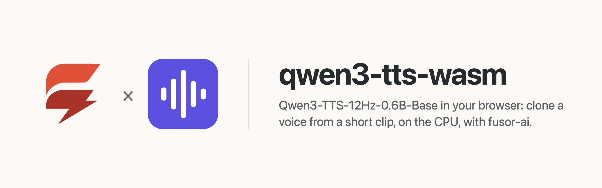
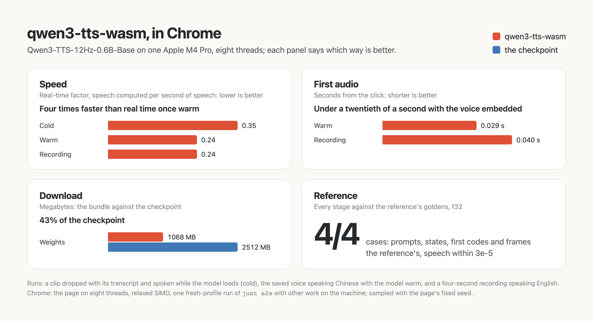

<p>
  <picture>
    <source media="(prefers-color-scheme: dark)" srcset="assets/brand/banner-dark.png">
    
  </picture>
</p>

# Clone a voice from a short clip, in the browser, on the CPU

**[Try it in your browser](https://huggingface.co/spaces/fusorlabs/qwen3-tts-wasm)**: no install, no server. The model downloads once and runs on your CPU.

**Speech 4× faster than real time, the first audio 30 to 40 ms after the click** once the model has loaded, in headless Chrome on an Apple M4 Pro, eight threads. [How fast is it](#how-fast-is-it)

<a href="https://huggingface.co/spaces/fusorlabs/qwen3-tts-wasm"></a>

Give Qwen's [Qwen3-TTS-12Hz-0.6B-Base](https://huggingface.co/Qwen/Qwen3-TTS-12Hz-0.6B-Base) a clip of 3 to 20 seconds of a voice (a file, or your microphone), the words it says if you know them, and a text in Chinese, English, German, Italian, Portuguese, Spanish, Japanese, Korean, French or Russian: it speaks the text in that voice, streamed to your speakers as it is computed on your own device. No server, no API key, no GPU required, and once the model has loaded, neither the clip nor the text leaves the page.

qwen3-tts-wasm is the app around the model: a [fusor](https://github.com/fusor-rs/fusor) page, the browser runtime and a native CLI. The model itself, compiled to WebAssembly, is built with [fusor-ai](https://github.com/fusor-rs/fusor-ai), the toolkit for AI runtimes in Rust and WebAssembly, from the published weights.

**In development · v0.1**: this is experimental software. See [status and known limitations](#status-and-known-limitations).

[Run it](#run-it-locally) · [Try it online](#try-it-online) · [How it works](#how-it-works) · [How fast is it](#how-fast-is-it) · [Status](#status-and-known-limitations)

## Run it locally

You need Rust 1.99 or newer, installed with [rustup](https://rustup.rs), Node.js 22 or newer and [`just`](https://github.com/casey/just). Then:

```sh
git clone --recurse-submodules https://github.com/fusor-rs/qwen3-tts-wasm && cd qwen3-tts-wasm
just ui
```

and open the address it prints. `just ui` installs the pinned tools (the threads toolchain with rustup; wasm-bindgen, binaryen and the fusor CLI into `.tools/`), downloads the checkpoint at a pinned revision (2.5 GB, each file sha256-checked), compiles it into a 1068 MB bundle, builds the four browser runtimes (a few minutes the first time, seconds after) and the page, and serves it on `http://localhost:8787` with the bundle beside it.

Drop an audio clip into the page, or **Record** yourself; the clip must run 3 to 20 seconds (a longer one is cut to its first 20). Add **what the clip says** for a closer clone: with the transcript the model continues the clip's own speech, without it only the voice's character carries over. Type a text, pick its language and press **Speak**, even while the model is still loading: it speaks the moment the model is ready. **Save voice** keeps a clip, its name and its transcript in this browser's storage (IndexedDB); nothing leaves the page. Every request is measured live: the first audio from the click, the real-time factor, the network requests since the model loaded (they stay at zero), and how alike the speech sounds to the voice (the cosine of their speaker embeddings).

## Try it online

Open the Hugging Face Space [fusorlabs/qwen3-tts-wasm](https://huggingface.co/spaces/fusorlabs/qwen3-tts-wasm) in Chrome or Edge. The page downloads the 1068 MB model once and keeps it in the browser's storage, so the next visit loads from this device.

## More ways to run it

### Build everything from source

```sh
just build    # also downloads the checkpoint (2.5 GB, sha256-checked) and compiles the bundle
just serve
```

`CHECKPOINT=<dir>` reuses a checkpoint you already have.

### The CLI

The CLI speaks in the voice of a 24 kHz WAV clip without a browser:

```sh
just speak --text "The morning train was late again." --language english --reference-text "What the clip says."
```

`qwen3-tts bench` measures each stage and `qwen3-tts parity` compares every stage with the reference's outputs (`just parity`). The fixed voice of the checks is a LibriSpeech dev-clean utterance (speaker 1272, [CC-BY-4.0](https://creativecommons.org/licenses/by/4.0/)).

## How it works

- **The reference's prompt, row for row.** The text goes through the model's speaking turn, the language and the voice's speaker embedding through the codec side, and with a transcript the clip's frames and transcript are read first, so the model continues the voice. Every row of every prompt matches the reference's.
- **A talker, a code predictor and a speech tokenizer.** A 28-layer Qwen3 talker draws each 80 ms frame's first code; five more layers draw its other 15; the speech tokenizer's decoder turns frames into 24 kHz samples through a sliding-window transformer and a streaming vocoder. A voice clip is encoded by the same tokenizer's Mimi encoder and by an ECAPA-TDNN speaker encoder.
- **Sampled as the model card says.** Each frame's codes are drawn with a temperature of 0.9 and the 50 likeliest kept, the first code penalized for repeating by 1.05, from a fixed seed; the checks decode greedily, as the reference's goldens do.
- **Quantized.** Every large matrix is 7-bit, 1068 MB against the 2.5 GB of f32 and bf16 weights; the text embedding is stored already through the text projection, and the encoder's codebooks stay f32.
- **One stage per step.** The engine worker speaks in steps (the voice, the prompt, then each frame) and posts each, so the speech streams and Stop takes effect between steps.
- **Threads and SIMD where the browser has them.** The page picks one of four builds: worker threads when it is cross-origin isolated, relaxed SIMD when the engine supports it, plain SIMD128 everywhere else.
- **Downloaded once, verified always.** The bundle streams in parts, each checked against its BLAKE3 hash, and stays in the browser's origin-private storage, so the next visit loads from this device.
- **Sealed.** The runtime imports no network, storage, clock or entropy capability; fusor-ai's import check proves it on every build. The page counts its network requests while it speaks, and the count is zero.

## How fast is it

On an Apple M4 Pro in headless Chrome on eight threads (`web-threaded-relaxed`), a request queued while the model loads gets its first audio 2.4 s after the page opens (the model loads in 1.8 s); with the model loaded and the voice already embedded, the first audio comes 29 ms (an English clip's continuation) to 40 ms after the click and the speech is computed in 0.24 of its length: 4.2× faster than real time. A revisit loads the 1068 MB bundle from the browser's storage in 1.3 s. Single-threaded, relaxed SIMD in Node computes a sentence in 1.5× its length, SIMD128 in 4.2×. Every fixed speech is intelligible (faster-whisper word and character error rates of 0) and sounds like the voice (a match of 0.98 or 0.99):

<picture>
  <source media="(prefers-color-scheme: dark)" srcset="assets/benchmarks/benchmarks-dark.png">
  
</picture>

These are the figures of one `just e2e` run and one `just demo` run (a fresh profile, other work on the machine); `just bench` breaks a request down by stage natively.

## Documentation

| Guide | Covers |
| --- | --- |
| [AGENTS.md](AGENTS.md) | The code standard every change follows |

## Status and known limitations

qwen3-tts-wasm is v0.1 and experimental.

| Platform or capability | Status |
| --- | --- |
| Chrome and Edge, threads and relaxed SIMD | Headless Chrome end-to-end check (`just e2e`): a dropped clip with its transcript, send while loading, a saved voice, a recording from a fake microphone, revisit |
| Browsers without relaxed SIMD (Safari, older Firefox) | SIMD128 builds, checked in Node (`just smoke`); not tested in those browsers |
| Pages without cross-origin isolation | Single-threaded builds |
| Native CLI (macOS on Apple silicon) | Built and run on the fixed voice; no release archives yet |
| Phones | Not measured; the threaded builds' memory may grow to 4 GB |

**Not supported yet:**

- Clips shorter than 3 s or longer than 20 s, and speech longer than 96 s.
- The base model's other modes: the model also ships voices for named speakers and voice design from a description, in other checkpoints.
- Speech past 300 frames in one request decoded as the reference's chunked decoder does: the decoder here keeps the whole stream's context.
- Bundles other than the 7-bit one.
- A GPU backend.

The model is Qwen's [Qwen3-TTS-12Hz-0.6B-Base](https://huggingface.co/Qwen/Qwen3-TTS-12Hz-0.6B-Base), under the Apache-2.0 license; the bundle ships the license beside its weights (`model/LICENSE`). The fixed voice is LibriSpeech dev-clean utterance 1272-141231-0030, [CC-BY-4.0](https://creativecommons.org/licenses/by/4.0/).

## License

The code is licensed under the [MIT License](LICENSE). The model's weights are Qwen's, under [Apache-2.0](https://huggingface.co/Qwen/Qwen3-TTS-12Hz-0.6B-Base/blob/main/LICENSE).
